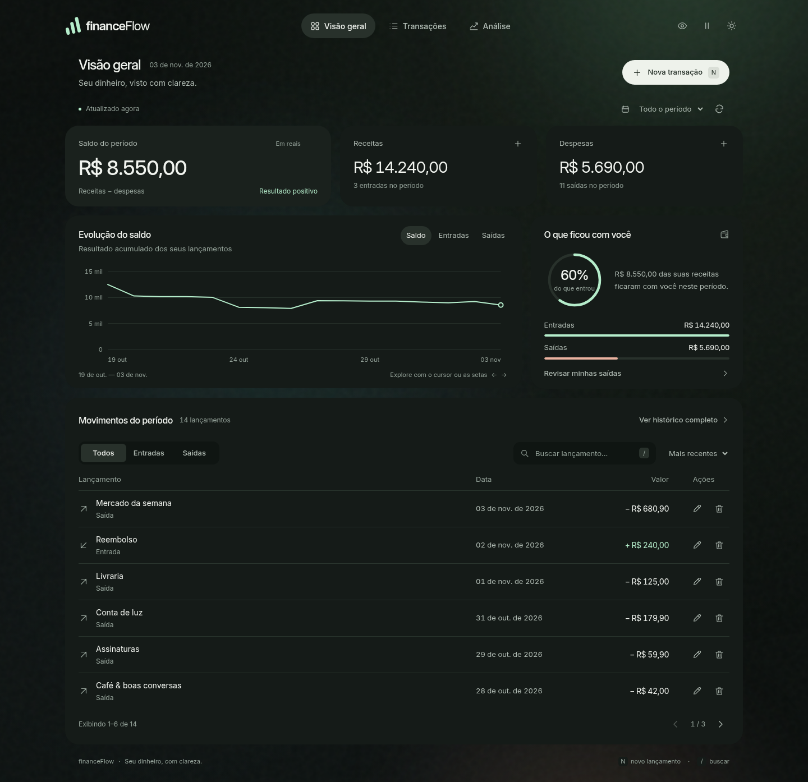

# financeFlow

Sistema de controle financeiro pessoal desenvolvido com Java, Spring Boot e PostgreSQL.

O FinanceFlow é uma aplicação full stack criada para facilitar o gerenciamento de receitas, despesas e saldos financeiros por meio de um dashboard web interativo.

O projeto foi desenvolvido com foco no aprendizado de desenvolvimento backend Java, arquitetura de APIs REST, persistência de dados, testes automatizados e boas práticas de programação.



Interface do FinanceFlow com indicadores financeiros, gráficos e gerenciamento de transações.

Tecnologias utilizadas

   ## Backend

- Java 25

- Spring Boot

- Spring Web

- Spring Data JPA

- Bean Validation

- Banco de dados

- PostgreSQL

- Flyway

     ## Frontend

- HTML5

- CSS3

- JavaScript

    ## Testes e ferramentas

- JUnit

- Maven

- Docker Compose

- Git e GitHub

     ## Funcionalidades

- Cadastro de receitas e despesas.

- Edição e exclusão de transações.

- Consulta do saldo financeiro.

- Dashboard com indicadores e gráficos.

- Filtros e pesquisa de transações.

- Validação de valores financeiros.

- Tratamento de erros na API.

- Interface responsiva com tema claro e escuro.

- Testes unitários e de integração.

## Arquitetura do projeto

A aplicação utiliza uma arquitetura organizada em camadas:

Frontend (HTML, CSS e JavaScript)
              |
              v
       API REST
              |
              v
     Controller (Spring)
              |
              v
     Service (Regras de negócio)
              |
              v
     Repository (Spring Data JPA)
              |
              v
       PostgreSQL

Essa separação facilita a manutenção, os testes e a evolução do sistema.

## Status do projeto

- Em desenvolvimento

O sistema já possui operações CRUD, persistência de dados, dashboard e testes automatizados.

Melhorias planejadas:

- Autenticação e autorização de usuários.

- Categorias financeiras.

- Relatórios financeiros.

- Deploy para demonstração pública.

Projeto desenvolvido para aprendizado prático de Java e construção de portfólio profissional.

## Requisitos

- JDK 25 (`java -version`).
- Docker com Docker Compose, para iniciar o PostgreSQL 17.
- O Maven é baixado pelo próprio projeto: `./mvnw` no Linux/macOS ou `mvnw.cmd` no Windows.

No IntelliJ, abra o arquivo `pom.xml` como projeto Maven e selecione o JDK 25. As dependências agora são gerenciadas pelo Maven; os JARs antigos em `lib/` não precisam ser adicionados manualmente.

## Executar localmente

Na pasta do projeto, defina `DB_PASSWORD` e `TEST_DB_PASSWORD` com senhas locais distintas no ambiente do terminal. No IntelliJ, configure as mesmas variáveis na configuração de execução. Não coloque senhas no código ou em commits.


```bash
docker compose up -d --wait db
./mvnw spring-boot:run
```

No PowerShell, use `.\mvnw.cmd spring-boot:run`. Aguarde a mensagem `Started FinanceFlowApplication`. A API escuta na porta 8080, apenas na máquina local por padrão. A primeira execução cria a tabela automaticamente com o Flyway; as próximas validam o esquema sem apagar os registros.

Esta versão substitui o menu do terminal pela API: as ações passam a ser feitas com requisições HTTP, consumidas pelo dashboard. Não são inseridas transações de exemplo no banco.

## Dashboard

A página inicial oferece três vistas: visão geral, transações e análise. O dashboard usa valores reais, gráfico com séries selecionáveis, busca, filtros, tema claro/escuro, tipografia local, movimento suave com opção de pausa e cadastro, edição e exclusão de transações.

Veja o [guia do dashboard](docs/dashboard.md), com captura de tela, instruções para Windows, atalhos e mapa de linhas para estudar os arquivos. Para editar os recursos diretamente durante o desenvolvimento:

```powershell
$env:PORT = "18081"
.\mvnw.cmd spring-boot:run "-Dspring-boot.run.addResources=true"
```

Abra `http://localhost:18081/`. As capturas no guia usam dados temporários de teste; seu banco não recebe exemplos automaticamente. A [revisão visual](docs/design-review.md) documenta a direção, as decisões de design e as verificações realizadas.

## Experimentar a API

Os exemplos abaixo usam curl no Bash. Também é possível usar Postman ou Insomnia. No PowerShell, use `curl.exe` e ajuste as aspas ou envie o JSON por essas ferramentas.

Cadastrar uma receita:

```bash
curl -i http://localhost:8080/api/transactions \
  -H 'Content-Type: application/json' \
  -d '{"description":"Salário","date":"2026-11-03","amount":3000.00,"type":"RECEITA"}'
```

Cadastrar uma despesa:

```bash
curl -i http://localhost:8080/api/transactions \
  -H 'Content-Type: application/json' \
  -d '{"description":"Conta de luz","date":"2026-11-03","amount":150.00,"type":"DESPESA"}'
```

O cadastro retorna HTTP **201**, o identificador gerado e o endereço do registro no cabeçalho `Location`. O valor deve ser positivo, com até duas casas decimais; o tipo determina se ele soma ou subtrai do saldo. A data usa o formato `AAAA-MM-DD`.

| Método | Endereço | Resultado |
| --- | --- | --- |
| POST | `/api/transactions` | Cadastra uma receita ou despesa |
| GET | `/api/transactions` | Lista as transações, das mais recentes para as mais antigas |
| GET | `/api/transactions/{id}` | Consulta uma transação pelo identificador |
| GET | `/api/transactions/balance` | Retorna o saldo: receitas menos despesas |
| PUT | `/api/transactions/{id}` | Edita uma transação existente |
| DELETE | `/api/transactions/{id}` | Exclui uma transação existente |

```bash
curl http://localhost:8080/api/transactions
curl http://localhost:8080/api/transactions/1
curl http://localhost:8080/api/transactions/balance
```

Com apenas as duas transações acima, o saldo será `{"balance":2850.00}`. Dados inválidos recebem HTTP **400**, com uma explicação; identificadores inexistentes recebem **404**. Dinheiro é representado por `BigDecimal` no Java e `NUMERIC(19,2)` no banco, evitando a imprecisão de `double`.

## Testes

Testes unitários, sem banco ou Docker:

```bash
./mvnw test
```

Testes completos, incluindo API e PostgreSQL real:

```bash
docker compose --profile test up -d --wait
./mvnw verify -Pintegration
```

Os cinco cenários originais foram preservados e adaptados ao repositório: adicionar transação, rejeitar valor negativo, rejeitar zero, rejeitar descrição vazia e calcular saldo. Há verificações adicionais de campos obrigatórios e precisão monetária.

Os testes de integração usam um banco separado na porta **5433**, exercitam HTTP, validação, migração e consultas reais. Cada teste desfaz suas alterações ao terminar. A porta **15432** é exclusiva do banco de desenvolvimento.

## Como o código está organizado

```text
src/main/java/com/financeflow/
  FinanceFlowApplication.java       inicia o Spring Boot
  transaction/
    TransactionController.java     recebe e responde requisições HTTP
    TransactionRequest.java        define e valida os dados de entrada
    TransactionResponse.java       define os dados devolvidos pela API
    TransactionService.java        aplica as regras do controle financeiro
    TransactionRepository.java     acessa o PostgreSQL através do JPA
    Transaction.java               representa uma linha da tabela transactions
    TransactionType.java           define RECEITA e DESPESA
  shared/ApiExceptionHandler.java   transforma erros em respostas HTTP
src/main/resources/db/migration/    histórico das mudanças do banco (Flyway)
src/test/                          testes unitários e de integração
```

O fluxo é **requisição → controller → service → repository → PostgreSQL**. A resposta percorre o caminho de volta. O Spring cria esses objetos e conecta suas dependências pelos construtores.

## Configuração e dados

| Variável | Padrão local                                    | Uso |
| --- |-------------------------------------------------| --- |
| `DB_URL` | `jdbc:postgresql://localhost:15432/financeflow` | Conexão JDBC da aplicação |
| `DB_USER` | `financeflow`                                   | Usuário do banco |
| `DB_PASSWORD` | obrigatória, sem valor padrão                               | Senha de desenvolvimento |
| `PORT` | `8080`                                          | Porta da API |
| Endereço local | `127.0.0.1`                                     | Interface de rede da API |

As senhas do banco principal (`DB_PASSWORD`) e de testes (`TEST_DB_PASSWORD`) são obrigatórias e não possuem valor padrão. Defina ambas no ambiente antes de iniciar o Compose e use a variável correspondente ao executar a aplicação ou os testes. Um arquivo `.env` é lido pelo Compose, mas não é carregado automaticamente pelo Spring Boot. Não versione credenciais reais.

O volume Docker `postgres_data` preserva os dados ao parar o banco. Para encerrar:

```bash
docker compose --profile test down
```

O comando acima mantém o volume. Evite `down -v` se quiser conservar as transações. Alterar a senha nas variáveis não muda a senha de um banco já inicializado.

Para gerar e executar o pacote:

```bash
./mvnw package
java -jar target/financeflow-0.1.0-SNAPSHOT.jar
```

## Próximas etapas

Categorias, relatórios agregados, filtros e paginação no servidor para volumes maiores, autenticação com separação dos dados de cada usuário e preparação da publicação para clientes. O dashboard e o CRUD de transações já estão disponíveis para desenvolvimento local.

## Segurança e limites de uso

Esta versão é uma aplicação de estudo para uso local, sem autenticação ou autorização. O servidor e as portas Docker permanecem vinculados a `127.0.0.1`; não exponha por proxy, túnel ou redirecionamento de portas. Ocultar valores no dashboard é apenas um recurso visual, não controle de acesso.

Para uma versão pública, implemente autenticação, autorização e HTTPS antes do deploy. Não use dados financeiros reais em demonstrações públicas.

As senhas antigas de desenvolvimento continuam no histórico: não as reutilize. Se seu volume PostgreSQL já foi inicializado, mudar uma variável não troca a senha existente. Altere a senha do usuário no PostgreSQL e configure o mesmo valor no ambiente; preserve o volume e faça backup antes de qualquer manutenção.

O Dependabot está configurado para propor atualizações Maven semanalmente. Revise e teste as propostas; isso não substitui uma auditoria de vulnerabilidades.
