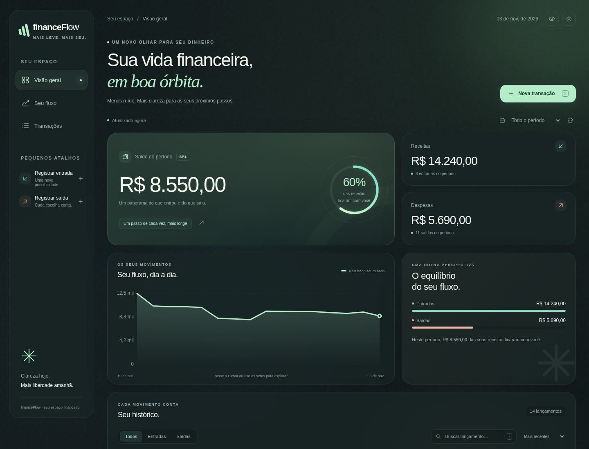

# Dashboard: guia de uso e estudo

Esta versão adiciona uma interface completa em HTML, CSS e JavaScript nativos. O Spring Boot serve os três arquivos em `src/main/resources/static`. O banco e os endpoints Java permanecem os mesmos.

## Abrir no seu computador

Com o PostgreSQL iniciado, no PowerShell, na pasta do projeto:

```powershell
docker compose up -d --wait db
$env:PORT = "18081"
.\mvnw.cmd spring-boot:run "-Dspring-boot.run.addResources=true"
```

Abra `http://localhost:18081/`. Mantenha uma única instância da aplicação nessa porta. Se ela já estiver em execução com `addResources=true`, basta atualizar o navegador com Ctrl + F5 depois de baixar os arquivos.

## O que funciona

- Cadastro de receitas e despesas, edição e confirmação de exclusão pela API real.
- Saldo, entradas, saídas e taxa de economia no período selecionado.
- Períodos: todo o histórico, mês atual, mês anterior e últimos 90 dias.
- Histórico com busca pela descrição, filtro de tipo, ordenação e paginação.
- Gráfico do resultado acumulado, com exploração pelo cursor e pelas setas do teclado.
- Tema claro/escuro e ocultação de valores, com preferências salvas no navegador.
- Atalho `N` para novo lançamento e `/` para buscar, quando o foco está fora de um campo.
- Layout adaptado ao celular, navegação inferior, formulários com foco e fechamento por Escape.
- Estados vazios e erros: falhas de atualização preservam os últimos dados recebidos.

As capturas usam dados temporários de teste. A interface não cadastra dados de demonstração automaticamente. No seu computador aparecem somente os registros da sua API.



[Ver captura do celular](images/dashboard-mobile.png)

## Como estudar, sem misturar os assuntos

1. **HTML e semântica:** acompanhe as seções da página, os identificadores (`id`) e as classes. O `dialog` é um elemento nativo que oferece a base de foco e navegação do formulário.
2. **CSS e layout:** comece pelas variáveis de cores; depois veja Grid, Flexbox, bordas, espaçamentos e os pontos de adaptação em `@media`. O fundo usa gradientes e uma textura SVG local.
3. **Dados no JavaScript:** leia `refresh()`, `periodRows()`, `totals()` e `render()`. Um GET da lista alimenta todos os indicadores do período, mantendo o mesmo conjunto de dados como referência.
4. **DOM e eventos:** acompanhe `renderTransactions()` e os `addEventListener`. Descrições do usuário entram por `textContent`; os SVGs dos botões são constantes do próprio código.
5. **Formulários e API:** leia `openTransaction()`, `saveTransaction()` e `confirmDelete()`. Eles usam POST, PUT e DELETE que já testamos no backend.
6. **Gráfico:** `buildSeries()` acumula entradas e saídas por data; `renderChart()` converte esses valores em posições SVG. Em intervalos longos, o gráfico agrupa os pontos, mantendo o valor acumulado nas datas exibidas.

Não é necessário instalar React, bibliotecas de gráficos, fontes ou outro servidor para executar esta versão.

## Mapa de linhas desta entrega

No VS Code, use **Ctrl + G**, digite o número da linha e pressione Enter. As linhas abaixo correspondem aos arquivos desta versão; alterações e formatação posteriores podem deslocá-las. Os comentários numerados identificam os mesmos blocos.

| Arquivo | Linha inicial | Bloco |
| --- | --- | --- |
| HTML | 20 | [01. Ícones locais: o painel funciona sem bibliotecas ou fontes externas.](../src/main/resources/static/index.html#L20) |
| HTML | 105 | [02. Navegação e atalhos que abrem o formulário real.](../src/main/resources/static/index.html#L105) |
| HTML | 235 | [03. Indicadores: todos usam dados reais, no período selecionado.](../src/main/resources/static/index.html#L235) |
| HTML | 319 | [04. Gráfico SVG interativo, construído a partir das transações.](../src/main/resources/static/index.html#L319) |
| HTML | 385 | [05. Busca, filtros, ordenação, paginação e ações por registro.](../src/main/resources/static/index.html#L385) |
| HTML | 493 | [06. Formulário compartilhado por cadastro e edição.](../src/main/resources/static/index.html#L493) |
| CSS | 1 | [01. Tema e cores: mude estas variáveis para transformar o painel inteiro.](../src/main/resources/static/css/styles.css#L1) |
| CSS | 148 | [02. Fundo: auroras suaves, textura e movimento bem discreto.](../src/main/resources/static/css/styles.css#L148) |
| CSS | 209 | [03. Estrutura e navegação.](../src/main/resources/static/css/styles.css#L209) |
| CSS | 648 | [04. Saldo e órbita: o círculo representa a taxa real de economia.](../src/main/resources/static/css/styles.css#L648) |
| CSS | 882 | [05. Gráfico e comparativo, sem números de demonstração.](../src/main/resources/static/css/styles.css#L882) |
| CSS | 1091 | [06. Histórico interativo.](../src/main/resources/static/css/styles.css#L1091) |
| CSS | 1364 | [07. Formulários e confirmação com o elemento nativo dialog.](../src/main/resources/static/css/styles.css#L1364) |
| CSS | 1571 | [08. Movimento e adaptação para tablets e celulares.](../src/main/resources/static/css/styles.css#L1571) |
| JavaScript | 3 | [01. Estado: os filtros ficam no navegador; os registros continuam no PostgreSQL.](../src/main/resources/static/js/app.js#L3) |
| JavaScript | 78 | [02. Dinheiro: BigInt guarda centavos inteiros, inclusive para valores grandes.](../src/main/resources/static/js/app.js#L78) |
| JavaScript | 221 | [03. Um mesmo conjunto de registros alimenta indicadores, gráfico e histórico.](../src/main/resources/static/js/app.js#L221) |
| JavaScript | 406 | [04. SVG: desenhamos apenas o resultado acumulado dos lançamentos existentes.](../src/main/resources/static/js/app.js#L406) |
| JavaScript | 603 | [05. Cadastro e edição usam o mesmo formulário e os endpoints que estudamos.](../src/main/resources/static/js/app.js#L603) |
| JavaScript | 764 | [06. Eventos: escutamos ações em vez de colocar JavaScript no HTML.](../src/main/resources/static/js/app.js#L764) |
| JavaScript | 959 | [07. Inicialização: preferências, data local e primeiro GET.](../src/main/resources/static/js/app.js#L959) |

## Dinheiro e datas

Os valores monetários são representados em centavos com `BigInt` no JavaScript. O leitor JSON preserva a escrita original dos números em navegadores atuais, evitando perder os centavos de valores grandes. Navegadores antigos recusam valores fora do caminho seguro em vez de apresentá-los arredondados. No formulário, valores como `1.250,50` e `1250.50` são aceitos. O POST/PUT envia o decimal como texto; o Jackson o lê como `BigDecimal` no contrato existente.

Datas de transações são datas sem horário. A apresentação e o gráfico preservam o dia cadastrado. O período usa o calendário local do navegador, inclusive na virada de mês.

A ocultação de valores é uma conveniência visual; a autenticação e a separação de dados entre contas ainda serão construídas antes da publicação para clientes.

## Validação realizada

- `./mvnw verify -Pintegration`: 17 testes unitários e 17 testes de integração, sem falhas ou skips.
- Chromium/Playwright: cadastro, edição, validação, cancelamento e exclusão no PostgreSQL de teste; filtros, pesquisa, ordenação, páginas, gráfico por teclado, persistência de tema e privacidade.
- Erros simulados: falha na leitura mantém os dados anteriores; falha na gravação mantém o formulário preenchido.
- Valor com 17 dígitos inteiros e dois centavos decimais preservado; descrição contendo HTML exibida como texto.
- Larguras de 320, 390, 760, 768, 1024 e 1440 px sem rolagem horizontal.
- Verificação automatizada axe-core, regras WCAG 2 A/AA e 2.1 AA, sem violações detectadas nos temas claro e escuro, com e sem o formulário aberto. Essa verificação automatizada não substitui avaliação humana de acessibilidade.

## Evolução planejada

Categorias, relatórios agregados no servidor, filtros e paginação no banco para volumes maiores, autenticação e isolamento dos dados de cada usuário. O dashboard atual é uma etapa de desenvolvimento pessoal; não é ainda uma implantação para múltiplos clientes.
