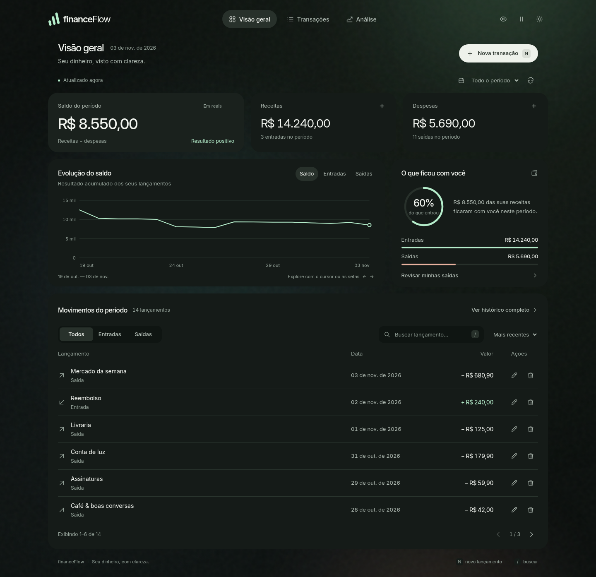

# Revisão do dashboard financeFlow

O aprimoramento mantém HTML, CSS, JavaScript nativos, a API Spring Boot, o PostgreSQL e a aurora animada aprovada. Não há dados de demonstração embutidos no frontend, migração de framework ou dependências de execução por CDN.

## Direção aplicada

Aplicada a skill [design-taste-frontend](https://github.com/Leonxlnx/taste-skill), no fluxo específico para aplicativos. Direção **True-black flat**, seed **1458210553**, escolhida entre as duas opções compatíveis com o tema escuro. Não houve novo sorteio. A tipografia é **Inter**, hospedada no próprio projeto; [licença SIL OFL 1.1](../src/main/resources/static/fonts/OFL-Inter.txt), compatível com uso comercial.

O elemento de identidade é o caminho do dinheiro: saldo em destaque, linha acumulada explorável e órbita de economia calculada sobre as receitas. Superfícies neutras e controles em branco deixam verde e pêssego para os dados financeiros. O fundo preserva os tons já aprovados.

Exceções explícitas: a aurora, seus gradientes e o movimento contínuo foram pedidos pelo usuário e prevalecem sobre a regra de fundo plano da skill. A inspeção usa somente `--allow gradient`; o lint anota essa mesma exceção nas funções CSS que desenham o fundo. O desfoque fica no fundo da janela modal, para separar o formulário da página. Não há desfoque nem sombras em cards. As cores do tema, curvas suaves e contraste de elevação foram adaptados à identidade existente.

## Conteúdo e tarefas

O objeto central é a transação: identificador, descrição de até 200 caracteres, data, valor em reais e tipo receita/despesa. Os valores vêm do GET existente e são guardados como centavos inteiros com `BigInt`. Nenhum total, crescimento, saldo projetado ou categoria é inventado.

Cada tela tem uma pergunta:

- **Visão geral:** quanto entrou, saiu e ficou no período? O saldo lidera os três indicadores; gráfico, economia e histórico permitem conferir a resposta.
- **Transações:** qual lançamento preciso encontrar ou ajustar? A lista ganha a área de trabalho, com pesquisa, filtros, ordenação, páginas e ações por registro.
- **Análise:** como os movimentos formam o resultado? Três séries acumuladas, maior saída, média por saída e dias com movimento usam os registros do mesmo período.

A navegação atualiza o endereço e funciona com voltar/avançar. Os filtros permanecem ao trocar de tela. As ações de cadastro, edição e exclusão continuam nos endpoints existentes. Não foi criado um sistema de categorias, contas bancárias ou usuários fictícios.

## Comparação visual

| Verificação | Antes | Depois |
| --- | --- | --- |
| Fonte efetivamente carregada | Segoe UI Variable e Georgia | Inter local |
| Título da tela | Chamada de 45 px, duas linhas | Título de 24 px, uma linha |
| Menor texto visível | 9 px | 11 px para metadados/eixos; dados principais em 13–14 px |
| Hierarquia | Cabeçalho de apresentação antes dos indicadores | Saldo e ações financeiras próximos do topo |
| Navegação | Âncoras na mesma página | Três vistas com endereço e histórico do navegador |
| Gráfico | Uma série acumulada e duas datas nas extremidades | Três séries selecionáveis, eixos arredondados e quatro datas no eixo |
| Privacidade | Valores monetários | Valores, taxa de economia e comparativos protegidos |
| Verificação da skill | 6 FAIL, 3 WARN | 0 FAIL, 0 WARN nas três telas e larguras |

### Avaliação do aplicativo, pelas sete perguntas da skill

1. **Resposta principal:** o saldo é a maior cifra; a tela de transações prioriza registros e a análise prioriza o gráfico.
2. **Composição:** marca, navegação e conteúdo usam uma coluna de até 1208 px; margens iguais, intervalos de 12–16 px e painéis que acompanham seu conteúdo.
3. **Identidade e cores:** números e gráfico carregam o acento; controles e navegação permanecem neutros. A aurora é a exceção aprovada.
4. **Consistência:** indicadores, gráfico e economia derivam dos mesmos registros filtrados por período. As repetições no comparativo conferem com os indicadores. A média arredonda os centavos inteiros.
5. **Zeros e ausências:** saldo e totais vazios são zero; média, maior saída e percentual sem base são traços. Contagens nomeiam lançamentos e dias.
6. **Leitura do gráfico:** abas nomeiam a série, marcas e tooltip usam os dados reais, quatro datas orientam o eixo. Lançamentos futuros aparecem em tracejado e são identificados como futuros, sem projeção automática.
7. **Celular:** os destinos cabem em uma faixa de navegação, os indicadores se reorganizam, a lista posiciona data e ações abaixo da descrição, e o formulário mantém foco e fechamento por Escape.

### Rodadas de revisão visual

**Antes.** O título e o saldo competiam pelo destaque; 36 blocos de texto estavam abaixo de 11 px, e o cabeçalho adiava a leitura dos movimentos. Prioridades: corrigir a tipografia, aproximar os dados do topo e reduzir ornamentos repetidos. A nota geral interna ficou limitada a 6,0 pelas falhas medidas.

**Rodada 1.** A hierarquia e as três vistas ficaram claras. A inspeção já registrou 0 FAIL, mas 51% do texto estava abaixo de 13 px. Três ajustes: ampliar dados e rótulos importantes, mover os atalhos dos indicadores para não quebrar o rodapé no celular, e reduzir a altura antes do histórico. Avaliação visual interna: design 7,4; uso 7,6; criatividade 7,0; conteúdo 8,0 — média ponderada 7,44.

**Rodada 2.** Rótulos importantes ampliados, atalhos dos indicadores reposicionados e painéis da análise equilibrados. A conferência das imagens identificou duas correções adicionais: abreviar as datas do eixo no celular e separar os identificadores das seções dos nomes das rotas para evitar a rolagem nativa ao abrir links diretos.

**Rodada 3, final.** Datas compactas sem colisões, links diretos abrindo no topo e revisão de todas as capturas do JAR, em desktop, tablet e celular. Avaliação visual interna: design 7,8; uso 8,3; criatividade 7,0; conteúdo 8,3 — média ponderada 7,84. São avaliações de trabalho, não uma certificação independente ou garantia de valor de venda.

## Dados das capturas

As imagens usam 14 lançamentos temporários no banco **de testes**, totalizando receitas de R$ 14.240,00, despesas de R$ 5.690,00 e saldo de R$ 8.550,00. O frontend não insere essas informações no banco do usuário.

Receitas: Salário, Freelance · identidade visual e Reembolso. Despesas: Mercado da semana, Aluguel, Conta de luz, Assinaturas, Café & boas conversas, Restaurante, Transporte, Academia, Internet, Livraria e Viagem planejada. Os registros temporários são removidos após a validação.

[Celular](images/dashboard-mobile.png) · [Transações](images/dashboard-transactions.png) · [Análise](images/dashboard-analysis.png)

## Validação final

- Maven: **17 testes unitários + 17 testes de integração**, sem falhas, erros ou testes ignorados.
- Navegador: **30 grupos de verificações** — 12 de funções financeiras, 10 de movimento e 8 de navegação/análise/privacidade/adaptação.
- Acessibilidade: **cinco auditorias axe-core**, regras WCAG 2 A/AA e 2.1 AA, sem violações detectadas.
- Skill: **0 FAIL e 0 WARN** nas três telas, em **1440, 768 e 390 px**, com a exceção explícita do fundo `gradient` aprovado. Todas as capturas foram abertas e revisadas.
- Lint da skill: **0 FAIL**. Os avisos restantes são o desfoque do fundo do modal, preenchimento com zero em datas/centavos e traços de valores ausentes; não são ornamentos ou textos de apresentação.
- Adaptação: seis larguras, incluindo 320 px; gráfico sem colisão das datas e links diretos abrindo no topo.
- Empacotamento: JAR executado; HTML, CSS, JavaScript e fonte servidos conferidos byte a byte com os arquivos da entrega.

A avaliação automatizada de acessibilidade não substitui testes humanos com leitores de tela. O acabamento visual é uma etapa do produto: autenticação, isolamento entre usuários e preparação para implantação comercial continuam no planejamento do projeto.
